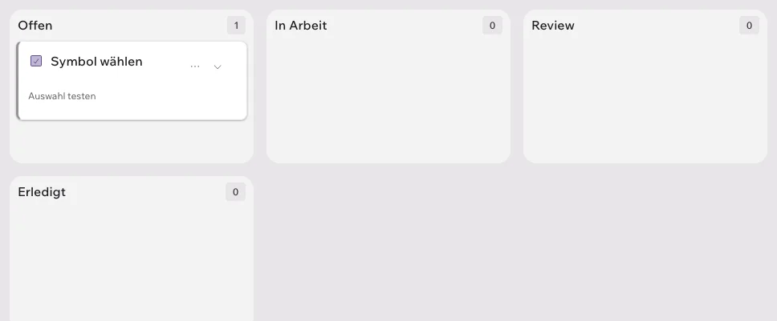

# Mollo Planer

[English](README.md) · **Deutsch**

Ein Projektplaner für kleine Teams und die KI-Agenten, mit denen sie arbeiten: Milestones, ToDos, Tasks und ein Kanban-Board, ein Assistent, der aus einer kurzen Beschreibung ganze Pläne entwirft, und ein eingebauter MCP-Server, über den Agenten wie Claude mit eigenem Konto Tasks übernehmen.



## Funktionen

### Pläne per Chat oder Sprache

Beschreib ein Projekt, einen Milestone oder eine einzelne Task in eigenen Worten, geschrieben oder gesprochen. Der Assistent entwirft den Plan und zeigt ihn als Baum mit Milestones, ToDos, Tasks, Personen und Daten. Mit weiteren Nachrichten verfeinerst du ihn; gespeichert wird erst, wenn du **Jetzt eintragen** wählst. Eine Kontext-Datei je Projekt gibt dem Assistenten Hintergrund, und lose Ideen lassen sich zuerst sammeln und später einplanen.

### Milestones, ToDos, Tasks und Kanban

Jedes Projekt ist gegliedert vom Release bis zum einzelnen Schritt: Milestones tragen eine Versionsnummer und lassen sich veröffentlichen, ToDos bündeln die Arbeit, Tasks wandern über das Kanban-Board. Die Zeitachse zeigt Fortschritt und Fälligkeit, ordnet nach Version und klappt alles auf einmal auf oder zu.

### Der Plan als Datei

Ein ganzer Plan lässt sich als lesbare Datei exportieren (Format `planer-v2`, JSON oder Markdown) und wieder importieren. Ein kleines Kommandozeilen-Werkzeug hält die Datei in einem Repository aktuell (`pull`, `push`, `sync`), und ein Webhook kann nach jeder Änderung eine GitHub Action starten.

### Ruhig arbeiten: Zen-Ansicht und Befehlspalette

Die Zen-Ansicht blendet die Navigation und alles aus, was du gerade nicht brauchst, mit eigenem, ruhigem Farbschema. Die Befehlspalette (`Cmd/Ctrl+K`) erreicht jede Seite, jedes Projekt und viele Aktionen über die Tastatur.

### Sicher von Anfang an

Ein zweiter Faktor ist für alle Pflicht: Authenticator-App oder Passkey, mit Wiederherstellungscodes. Rechte gelten je Projekt, über Rollen, die Admins anpassen können. Neue Konten warten auf eine Freigabe. Der Planer kann auch der Anmeldedienst für andere Apps sein (OAuth 2.1 und OpenID Connect).

### Läuft auf einfachem Webhosting

Kein Node, kein Docker, keine Root-Rechte und kein Prozess, der dauernd läuft. Du brauchst:

- PHP 8.5 mit gängigen Erweiterungen (unter anderem `gd`, `sodium`, `bcmath`, `mbstring`, `pdo_mysql`)
- Apache mit `mod_rewrite`
- MariaDB
- einen Cron-Eintrag
- SSH mit Git und Composer, für Einrichtung und Updates

Das Frontend wird vorher gebaut und als statische Dateien hochgeladen. Details: [docs/installation.md](docs/installation.md).

### Agenten als Teammitglieder

KI-Agenten bekommen ein eigenes Konto mit der Rolle «Agent» und nur die Rechte dieser Rolle. Sie übernehmen Tasks, setzen den Status, tragen den Commit an der Task ein und berichten in Kommentaren, wie alle anderen im Team. Der Planer selbst entsteht so.

### Ein MCP-Server, der Tokens spart

Claude und andere Agenten verbinden sich über das Model Context Protocol, mit einem persönlichen Zugang oder per OAuth. Die vierzehn Werkzeuge lesen in Stufen statt alles auf einmal: Der Überblick über ein Projekt kostet rund 1000 Tokens, eine einzelne Task wenige hundert. Eine Anleitung für Agenten liegt unter `/mcp/`.

### Ausserdem

- **Dokumente** je Projekt (Protokolle, Vorgehensweisen, Analysen), für alle oder für einzelne Personen freigegeben, mit Versionsverlauf und PDF-Export
- **Abrechnung** aus erledigten Milestones: Preise je Milestone, Kunden, Rechnungen als PDF mit Schweizer QR-Rechnung
- **Handbuch** in der App unter «Hilfe», deutsch und englisch, mit oder ohne Bilder, und als Markdown und `llms.txt` für Agenten
- **Deutsch und Englisch** durchgehend
- Ideen, Projektvorlagen, Label-Sets, Statistik je Projekt, Papierkorb

## Für wen

Kleine Teams und Einzelne, die Software oder andere Projekte planen, einen Teil der Arbeit KI-Agenten überlassen und ihren Planer selbst betreiben wollen.

## Technik

- **Backend:** Laravel 13 mit PHP 8.5, GraphQL mit Lighthouse, Fortify und Sanctum für die Anmeldung, MariaDB
- **Frontend:** Nuxt 4 (Vue 3) als Single-Page-App, Web Awesome Pro, TipTap für Rich Text
- **Agenten:** MCP-Server im Backend, Claude-API für den Assistenten, `tools/planer/` für die Plan-Datei

## Dokumentation

- **Bedienung:** das Handbuch, in der App unter «Hilfe» und in [`handbuch/`](handbuch/)
- [docs/installation.md](docs/installation.md): Anforderungen und erste Einrichtung
- [docs/lokal.md](docs/lokal.md): lokal arbeiten, Demo-Daten, Postman, Claude anbinden
- [docs/deployment.md](docs/deployment.md): automatisches Deployment in zwei Umgebungen
- [docs/betrieb.md](docs/betrieb.md): Nutzer auf dem Server verwalten
- [docs/claude-connector.md](docs/claude-connector.md): alle Werkzeuge des MCP-Servers
- [docs/README.md](docs/README.md): alle Entscheide und Pläne

## Ausprobieren

Du brauchst PHP 8.5 mit Composer, Node 24 und eine Lizenz für [Web Awesome Pro](https://webawesome.com): Ohne sie lässt sich das Frontend nicht bauen (Einrichtung in [frontend/README.md](frontend/README.md)). Font Awesome Pro ist freiwillig; ohne es nimmt der Planer die freien Symbole.

```bash
git clone https://github.com/oliversteiner/mollo-planer.git && cd mollo-planer/backend
composer install && cp .env.example .env && php artisan key:generate
touch database/database.sqlite && php artisan migrate
php artisan db:seed --class=DemoSeeder   # fragt nach einem Passwort (leer: eines wird erzeugt), zeigt es einmal
php artisan serve                        # API auf http://localhost:8000

# zweites Terminal, mit WEBAWESOME_NPM_TOKEN und frontend/.npmrc wie in frontend/README.md
cd mollo-planer/frontend && npm ci && npm run dev   # App auf http://localhost:3000
```

Melde dich als `anna.keller@example.ch` (Admin) mit dem Passwort an, das der Seeder angezeigt hat. Einen Server einrichten: [docs/installation.md](docs/installation.md).

## In Arbeit

Anhänge an Tasks, ein Protokoll der Änderungen, mehrere Commits je Task, gemeinsames Bearbeiten von Dokumenten in Echtzeit, eine Desktop-App. Ohne Termine.

## Lizenz

Lizenz in Vorbereitung: geplant ist die GNU AGPL v3.0 oder später. Bis sie im Repository steht, sind alle Rechte vorbehalten. Web Awesome Pro und Font Awesome Pro gehören nicht zum Repository und brauchen eine eigene Lizenz.
