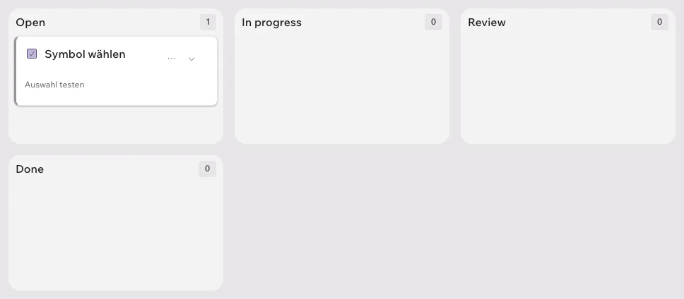

# Mollo Planer

**English** · [Deutsch](README.de.md)

A project planner for small teams and the AI agents they work with: milestones, to-dos, tasks and a kanban board, an assistant that drafts whole plans from a short description, and a built-in MCP server through which agents like Claude take on tasks with their own account.



## Features

### Plans by chat or voice

Describe a project, a milestone or a single task in your own words, typed or spoken. The assistant drafts the plan and shows it as a tree with milestones, to-dos, tasks, people and dates. You refine it with further messages; nothing is saved until you select **Add now**. A context file per project gives the assistant background, and loose ideas can be collected first and planned later.

### Milestones, to-dos, tasks and kanban

Each project is structured from release down to the single step: milestones carry a version number and can be released, to-dos group the work, tasks move across the kanban board. The timeline shows progress and due dates, sorts by version and expands or collapses all at once. The status of to-dos and milestones follows from their tasks; nobody sets it by hand.

### The plan as a file

A whole plan can be exported as a readable file (format `planer-v2`, JSON or Markdown) and imported again, always with a dry run first. A small command-line tool keeps the file in a repository up to date (`pull`, `push`, `sync`), and a signed webhook can start a GitHub Action after every change.

### Calm work: Zen view and command palette

Zen view hides the navigation and everything you don't need right now, in its own calm colour scheme. The command palette (`Cmd/Ctrl+K`) reaches every page, every project and many actions from the keyboard.

### Secure from the start

A second factor is required for everyone: an authenticator app or a passkey, with recovery codes. Rights are granted per project through roles that admins can adjust. New accounts wait for approval. The planner can also be the sign-in service for other apps (OAuth 2.1 and OpenID Connect).

### Runs on simple web hosting

No Node, no Docker, no root access and no long-running process on the server. You need:

- PHP 8.5 with common extensions (including `gd`, `sodium`, `bcmath`, `mbstring`, `pdo_mysql`)
- Apache with `mod_rewrite`
- MariaDB
- one cron job every minute (it also sends the queued mails)
- SSH with Git and Composer, for setup and updates

The frontend is built beforehand and uploaded as static files. Details: [docs/installation.md](docs/installation.md) (German).

### Agents as team members

AI agents get their own account with the role «Agent», an identifier instead of an e-mail address, and only the rights of that role. They pick up tasks, set the status, record the commit on the task and report back in comments, like anyone else on the team. The planner itself is built this way.

### An MCP server that saves tokens

Claude and other agents connect through the Model Context Protocol, with a personal access token or OAuth. The fourteen tools read in steps instead of loading everything: an overview of a project costs about 1,000 tokens, a single task a few hundred. Agents change status, commit and assignee directly, without exporting the plan first. A guide for agents is served at `/mcp/`.

### Also included

- **Documents** per project (minutes, procedures, analyses), shared with everyone or with single people, with version history and PDF export
- **Billing** from completed milestones: prices per milestone, customers, invoices as PDF with Swiss QR bill
- **Manual** in the app under Help, in German and English, with or without pictures, and as Markdown and `llms.txt` for agents
- **German and English** throughout; mails in the language of the project
- Ideas, project templates, label sets, statistics per project, trash

## Who it is for

Small teams and individuals who plan software or other projects, let AI agents do part of the work and want to host their planner themselves.

## Technology

- **Backend:** Laravel 13 on PHP 8.5, GraphQL with Lighthouse, Fortify and Sanctum for sign-in, MariaDB
- **Frontend:** Nuxt 4 (Vue 3) as a single-page app, Web Awesome Pro, TipTap for rich text
- **Agents:** MCP server in the backend, Claude API for the assistant, `tools/planer/` for the plan file

## Documentation

- **Using the planner:** the manual, in the app under Help and in [`handbuch/`](handbuch/)
- [docs/installation.md](docs/installation.md): requirements and first setup (German)
- [docs/lokal.md](docs/lokal.md): working locally, demo data, Postman, connecting Claude (German)
- [docs/deployment.md](docs/deployment.md): automatic deployment to two environments (German)
- [docs/betrieb.md](docs/betrieb.md): managing users on the server (German)
- [docs/claude-connector.md](docs/claude-connector.md): all MCP tools (German)
- [docs/README.md](docs/README.md): all decisions and plans (German)

## Try it

You need PHP 8.5 with Composer, Node 24 and a licence for [Web Awesome Pro](https://webawesome.com): the frontend does not build without it (setup in [frontend/README.md](frontend/README.md)). Font Awesome Pro is optional; without it the free icons are used.

```bash
git clone https://github.com/oliversteiner/mollo-planer.git && cd mollo-planer/backend
composer install && cp .env.example .env && php artisan key:generate
touch database/database.sqlite && php artisan migrate
php artisan db:seed --class=DemoSeeder   # asks for a password (empty: one is made), shows it once
php artisan serve                        # API on http://localhost:8000

# second terminal, with WEBAWESOME_NPM_TOKEN and frontend/.npmrc as in frontend/README.md
cd mollo-planer/frontend && npm ci && npm run dev   # app on http://localhost:3000
```

Sign in as `anna.keller@example.ch` (admin) with the password the seeder printed. Setting up a server: [docs/installation.md](docs/installation.md) (German).

## In progress

Attachments on tasks, an activity log, several commits per task, real-time editing of documents, a desktop app. No dates promised.

## Licence

Mollo Planer is free software under the [GNU Affero General Public License v3.0 or later](LICENSE): whoever offers it as a service shares their changes. Web Awesome Pro and Font Awesome Pro are not part of this repository and need their own licence.
