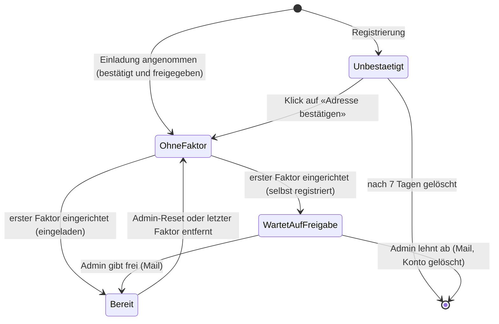

# Onboarding-Leitfaden: Registrierung bis erste Arbeitssitzung

Stand: 2026-11-18 · Autor: Fable · Gilt für Projekte mit dem Stack **Laravel 13 (Fortify, Sanctum SPA-Cookies, `laravel/passkeys`, Lighthouse), MariaDB, Nuxt 4 als reine SPA, Web Awesome**.

Herkunft: Gutachten `docs/onboarding-gutachten.md` (Quellen dort) und die Umsetzung im Mollo Planer (Aufträge 18 bis 24). Was hier als «bewährt» steht, ist im Mollo Planer gebaut und getestet. Was «Vorschlag» heisst, ist noch nicht gebaut. Das Schwesterprojekt habe ich nicht gelesen; Abschnitt 8 und 9 nennen, was dort zuerst zu prüfen ist.

Inhalt: 1 Leitsätze · 2 Ablauf · 3 Architektur Backend · 4 Architektur Frontend · 5 Verträge · 6 Tests · 7 Stolpersteine · 8 Kapselung · 9 Einbau in ein weiteres Projekt · 10 Offene Punkte

---

## 1. Leitsätze

| Nr. | Leitsatz | Warum |
|---|---|---|
| G1 | **Der Server kennt den Zustand, das Frontend leitet daraus die Seite ab.** | Abbruch, Neuladen und Gerätewechsel funktionieren nur so. |
| G2 | **Jeder Link aus einer Mail funktioniert ohne Sitzung.** | Mailprogramme öffnen Links in einem anderen Browser als dem der Registrierung. |
| G3 | **Ein Link allein ändert nichts.** Aufrufen prüft, ein Knopf bestätigt. | Mail-Scanner und Vorschauen rufen Links vorab auf. |
| G4 | **Kein Mail-Link meldet an.** | Der Link beweist Zugriff aufs Postfach, nicht Kenntnis des Passworts. |
| G5 | **Öffentliche Formulare antworten für jede Adresse gleich** (Registrierung, Passwort vergessen, erneut senden): gleicher Status, gleicher Körper. Wer ein Konto hat, erfährt es per Mail. | Schutz der Mitgliederliste. |
| G6 | **Der zweite Faktor wird auf dem Server erzwungen** und ist in Produktion nicht abschaltbar. | Eine Sperre nur im Frontend ist keine. |
| G7 | **Kein Schritt endet stumm.** Jede Antwort führt weiter oder sagt, warum nicht. | Die zwei schwersten Fehler im Mollo Planer waren Seiten, die nach Erfolg stehen blieben. |
| G8 | **Alle Konto-Mails laufen über die Queue**, mit `afterCommit`, in der Sprache der Person. | Antwortzeit verrät nichts, ein Mailfehler bricht keinen Ablauf ab. |
| G9 | **Jede Änderung an der Anmeldung erzeugt eine Mail an die Person.** | Einziger Hinweis bei fremdem Zugriff. |
| G10 | **Passwörter: Länge statt Regeln.** Mindestens 12 Zeichen, Abgleich mit bekannten Passwörtern, keine Vorgaben zur Zusammensetzung. | NIST SP 800-63B-4. |
| G11 | **Der Weg um den zweiten Faktor herum ist eng und sichtbar:** nur Admin-Reset, mit Rückfrage zur Identität, Mail und Protokoll. | Sonst ist der Reset die Schwachstelle. |
| G12 | **Texte in Du-Form, sagen was passiert ist, was kommt und was zu tun ist.** Hinweise von Gewicht stehen fest auf der Seite, nicht in einem Toast. | Verständlichkeit, Barrierefreiheit. |

Abwägung zu G5: Bequemer wäre der Feldfehler «bereits vergeben». Für geschlossene Anwendungen mit Freigabe wiegt der Schutz schwerer. Wer es anders will, entscheidet das je Projekt bewusst (Schalter in Abschnitt 8).

---

## 2. Ablauf

### 2.1 Zustände eines Kontos

Die Reihenfolge der Sperren ist fest: **Sitzung → E-Mail bestätigt → zweiter Faktor → Freigabe**. Die Freigabe ist ein Schalter je Projekt (Abschnitt 8); ohne sie fällt der Zustand «Wartet auf Freigabe» weg.

### 2.2 Schritte

| Schritt | Seite | Was die Person sieht | Randfälle |
|---|---|---|---|
| 1 Registrieren | `/register` | Name, E-Mail, Passwort (Hinweis «Mindestens 12 Zeichen») | Adresse vergeben: gleiche Antwort, Mail «Du hast schon ein Konto» bzw. «Registrierung noch nicht bestätigt». Fehler nur zu Name, Format, Passwort. |
| 2 E-Mail bestätigen | `/account-pending?reason=email` | Adresse, Frist (60 Minuten), Spam-Hinweis, «kann eine Minute dauern», «erneut senden», «Adresse falsch? Nochmals registrieren» | Seite sieht mit und ohne Sitzung gleich aus. Erneut senden: angemeldet ein Knopf, sonst Adressfeld; Antwort immer neutral. |
| 3 Link aus der Mail | `/verify-email?id…&hash…&expires…&signature…` | Knopf «E-Mail-Adresse bestätigen» | Abgelaufen, verändert, Konto weg: `?status=invalid` mit «erneut senden». Schon bestätigt: eigener Text. Nach dem Klick ohne Sitzung: «Melde dich jetzt an und richte deinen zweiten Faktor ein.» |
| 4 Anmelden | `/login` | E-Mail und Passwort, oder Passkey | Fehler immer «Diese Zugangsdaten stimmen nicht». Konto nur mit Passkey nach Passwort: Hinweis «Melde dich mit dem Passkey an». |
| 5 Konto absichern | `/setup-security` | «Schritt 1 von 2»: Passkey (empfohlen, mit Erklärung) oder Authenticator-App. «Schritt 2 von 2»: Codes sichern (App) bzw. Abschluss mit Hinweis auf zweiten Weg (Passkey) | Kein erneutes Passwort direkt nach der Anmeldung. Abbruch des Passkey-Dialogs: Meldung mit Ausweg. Codes: Kästchen «gespeichert» vor «Fertig». |
| 6 Freigabe ausstehend | `/account-pending?reason=approval` | «Ein Admin schaltet dein Konto frei. Du bekommst eine Mail. Du musst nichts tun.» | Admins bekommen eine Mail je bestätigtem Konto. Freigabe und Ablehnung schicken der Person eine Mail. |
| 7 Arbeitssitzung | Startseite | | |
| Passwort vergessen | `/forgot-password` → `/reset-password` | Immer derselbe Erfolgstext | Token 60 Minuten, einmalig. Danach alle Sitzungen und Zugänge beendet, Mail «Passwort geändert», keine automatische Anmeldung. Der zweite Faktor bleibt. |
| Faktor verloren | Abfrageseite | «Kein Zugriff mehr? Melde dich bei einem Admin.» | Wiederherstellungscode, sonst Admin-Reset (G11). Danach wieder Schritt 5. |

---

## 3. Architektur Backend

### 3.1 Bausteine

| Baustein | Aufgabe | Im Mollo Planer |
|---|---|---|
| Registrierung | neutrale Antwort, Hinweis-Mail, Sprache speichern | `RegisterController`, `CreateNewUser`, `RegistrationForExistingAddress` |
| Bestätigung | GET prüft, POST bestätigt, erneut senden (mit und ohne Sitzung) | `EmailVerificationController`, `VerifyRegistrationEmail` |
| Passwort vergessen | neutrale Antwort, Drossel | `NeutralPasswordResetLinkResponse`, `ResetUserPassword` |
| Passwortregel | eine Stelle für alle Wege | `PasswordPolicy`, `Password::defaults` |
| Starke Sitzung | Markierung in der Sitzung, drei Sperren, Schutz der Konto-Routen | `StrongAuthentication`, `EnsureEmailVerified`, `EnsureStrongAuthentication`, `EnsureApproved`, `ProtectAccountSecurityRoutes`, `AccountReadiness` |
| Faktoren und Zugänge | Reset, Sitzungen und Tokens beenden | `UserSecurity` |
| Freigabe | freigeben, ablehnen, Mails | `ReviewRegistration`, `AccountApproved`, `AccountRejected`, `UserAwaitingApproval` |
| Sicherheitsmails | eine Mail je Ereignis | `NotifyOfSecurityChange`, `SecurityChange` |
| Komfort | Anmeldung zählt als Passwortbestätigung | `ConfirmPasswordOnLogin` |
| Betrieb | Aufräumen, Befehle für Notfälle per SSH | `app:prune-unverified-users`, `app:user-password`, `app:user-email`, `app:user-2fa` |

### 3.2 Routen (alle REST in der Gruppe `web`, nicht GraphQL)

| Methode und Pfad | Schutz | Antwort |
|---|---|---|
| `POST /register` | Gast, 5/Min. je IP | `201`, leerer Körper, in jedem Fall |
| `GET /email/verify/{id}/{hash}` | signiert, 20/Min. je IP | Weiterleitung auf die SPA mit den Parametern oder `status=invalid` |
| `POST /email/verify/{id}/{hash}` | signiert, 20/Min. je IP | `200` mit `status`: `ok`, `already`, `invalid` |
| `POST /email/verification-notification` | Sitzung, 1/Min. | `202`, oder `204` wenn schon bestätigt |
| `POST /email/verification-notification/guest` | 3/Std. je Adresse und je IP | `202`, immer gleich |
| `POST /forgot-password`, `POST /reset-password` | Gast, 5/Min. je IP | `200` immer gleich bzw. Fortify |
| `POST /login`, `/two-factor-challenge`, `/passkeys/*`, `/user/*` | Fortify, eigene Drosseln | Fortify |

Die Fortify-Features `registration` und `emailVerification` sind **aus**; die eigenen Routen ersetzen sie. Sonst verdeckt oder widerspricht die Fortify-Route.

### 3.3 Daten

| Tabelle | Spalte | Bedeutung |
|---|---|---|
| `users` | `email_verified_at` | Bestätigung |
| `users` | `approved_at` (nullable) | Freigabe; von Admins angelegte Konten sofort gesetzt |
| `users` | `locale` (`string(5)`, nullable) | Sprache für Mails ausserhalb einer Anfrage der Person; `null` heisst Standardsprache |
| `users` | `two_factor_*` | Fortify |
| `passkeys` | | `laravel/passkeys` |
| `sessions` | | Treiber `database`, sonst lassen sich Sitzungen nicht gezielt beenden |
| `password_reset_tokens` | | zwei Broker: `users` (60 Min.), `invitations` (7 Tage) |

### 3.4 Konfiguration je Umgebung

| Wert | Regel |
|---|---|
| `APP_URL` | exakt die Adresse, unter der die API Aufrufe sieht (Schema und Host). Die Signatur des Bestätigungslinks hängt daran. |
| `FRONTEND_URL` | Ursprung der SPA: CORS, Mail-Links, RP-ID und erlaubter Ursprung der Passkeys |
| `SESSION_DOMAIN`, `SANCTUM_STATEFUL_DOMAINS` | SPA und API unter derselben Hauptdomain |
| CORS-Pfade | **jede** neue REST-Route aufnehmen (`register`, `email/*`, `user/*`, `passkeys/*` …) |
| `PASSWORD_UNCOMPROMISED_CHECK` | in Produktion an; aus nur in Tests ohne Netz |
| Queue | Cron mit `schedule:run`; Mails brauchen bis zu einer Minute, die Texte sagen das |

### 3.5 Regeln, die im Code gelten

- Passwörter nur über `Password::default()`; kein Weg mit eigener, schwächerer Regel.
- Mails nur als Notification mit `ShouldQueue` und `afterCommit`. Löscht eine Aktion das Konto, trägt die Mail Name und Adresse selbst.
- Sprache: Ändert die Person selbst etwas, gilt ihre gespeicherte Sprache, sonst die der Anfrage. Handelt jemand anderes (Admin), gilt die gespeicherte Sprache, sonst die Standardsprache, nie die des Admins.
- Links in Mails kommen aus fester Konfiguration, nie aus dem Host der Anfrage.
- Rechte nur über die Rechteverwaltung des Projekts; das Onboarding kennt keine Rollennamen.

---

## 4. Architektur Frontend

| Baustein | Aufgabe | Im Mollo Planer |
|---|---|---|
| Zustandsabfrage | fragt den Server, liefert «alles gut» oder den Grund | `useViewer().load()` |
| **Eine** Funktion «Antwort → Ziel oder Meldung» | rein, ohne Nuxt testbar; kennt den Anlass (`opened`, `submitted`, `continued`) | `utils/account-outcome.ts`, `useAccountFlow` |
| Seiten | `login`, `register`, `verify-email`, `account-pending`, `setup-security`, `forgot-password`, `reset-password`, `invitation` | `pages/` |
| Bausteine | erneut senden, Passkey hinzufügen, App einrichten, Codes, Passwort setzen | `AuthResendVerification`, `SecurityPasskeyAdd`, `SecurityTwoFactorSetup`, `SecurityRecoveryCodes`, `AuthSetPasswordForm` |
| REST-Client | Cookies, CSRF-Cookie vor jedem Aufruf, `419` einmal wiederholen, Fehler einordnen | `plugins/api.ts`, `utils/api.ts` |
| Wächter | öffentliche Seiten markiert, alles andere braucht eine starke Sitzung | `middleware/auth.global.ts` |

Regeln:

- Die Auth-Seiten rufen alle dieselbe Funktion; Sonderfälle je Seite sind Parameter, keine Kopien.
- Beim **Öffnen** einer Seite bleibt eine halbe Sitzung stumm; nur nach einer **Eingabe** gibt es Hinweise.
- Die Seite nach der Registrierung sieht mit und ohne Sitzung gleich aus (sonst verrät sie den Fall).
- Die Adresse wandert im Speicher der SPA, nie in der URL.
- `ssr: false` und `wa-*` als Custom Elements: keine Hydration-Fragen.
- Texte nur über `i18n`, DE und EN mit gleichen Schlüsseln.

---

## 5. Verträge

**Sperr-Antworten der API** (HTTP 403, GraphQL-Fehler mit `extensions`):

| `code` | Zusatz | Frontend |
|---|---|---|
| `ACCOUNT_NOT_READY` | `reason: email`, `email` (eigene Adresse) | Seite «E-Mail bestätigen» |
| `ACCOUNT_NOT_READY` | `reason: approval` | Seite «Freigabe ausstehend» |
| `SECOND_FACTOR_SETUP_REQUIRED` | | `/setup-security` |
| `STRONG_AUTHENTICATION_REQUIRED` | | nach Passwort: Passkey-Hinweis; sonst Anmeldung |

**Abfrage `Viewer`** liefert `approved` und `emailVerified`; sie bleibt für Konten offen, die auf die Freigabe warten.

**Mails** (alle DE/EN): Bestätigung (mit Frist und Warnung), «Du hast schon ein Konto», «Registrierung noch nicht bestätigt», Passwort-Reset, Einladung, Konto wartet (an Admins), Freigabe, Ablehnung, Sicherheitsänderung (Passwort, App hinzugefügt oder entfernt, Passkey hinzugefügt oder entfernt, neue Codes, Admin-Reset).

---

## 6. Tests

### 6.1 Backend (Feature-Tests, je Punkt mindestens einer)

| Bereich | Muss geprüft sein |
|---|---|
| Registrierung | neue und vergebene Adresse: gleicher Status und Körper; keine Sitzung und kein zweites Konto bei «vergeben»; Hinweis-Mail einmal pro Stunde; unbestätigtes Konto bleibt unverändert; Gross-/Kleinschreibung und Leerzeichen; zwei Registrierungen gleichzeitig ohne Fehler 500; Drossel |
| Bestätigung | GET bestätigt nichts; POST bestätigt ohne Sitzung und meldet niemanden an; zweiter POST `already`; abgelaufen, verändert, falscher Hash, unbekannte ID alle `invalid`; eigene Route nicht von Fortify verdeckt; Signatur aus `APP_URL` hält; Mail in der Queue; CORS mit dem Ursprung der SPA |
| Erneut senden | mit Sitzung `202`/`204` und Drossel; ohne Sitzung gleiche Antwort für bekannte, bestätigte und unbekannte Adresse, nur eine Mail |
| Passwort vergessen | bekannte, unbekannte und gedrosselte Adresse gleich; Drossel je IP; nach Reset Sitzungen und Tokens weg, niemand angemeldet |
| Passwortregel | 11 abgelehnt, 12 angenommen; bekanntes Passwort abgelehnt (Antwort gefälscht); Dienst weg → angenommen, ohne lange Wartezeit; jeder Weg nutzt die Regel |
| Starke Sitzung | ohne Faktor → Einrichtung; mit Faktor ohne Nutzung → gesperrt; Markierung gilt nur für den eigenen Nutzer; Passwort allein übernimmt kein Passkey-Konto; erster Faktor nach Reset macht die Sitzung stark |
| Freigabe | Mail in der Sprache der Person; zweite Freigabe ohne zweite Mail; Ablehnung schickt die Mail trotz gelöschtem Konto |
| Sicherheitsmails | je Ereignis genau eine; Einrichtung der App eine, nicht zwei; erstes Passwort einer Einladung keine |
| Admin-Reset | Mail, Protokollzeile mit Admin und Nutzer, ohne Adresse |

Grundregeln der Suite: `Http::preventStrayRequests()` in der Basisklasse, ein gemeinsames Testpasswort mit mindestens 12 Zeichen, nach Migrationen zusätzlich gegen MariaDB.

### 6.2 Frontend (Vitest)

- Die Funktion «Antwort → Ziel» als reine Einheit: jede Antwort mal jeder Anlass.
- Je Seite die Zustände: `verify-email` (bereit, bestätigt, schon bestätigt, ungültig, mit und ohne Sitzung, POST erst nach Klick), `account-pending` (mit und ohne Sitzung gleich), `login` (Hinweis nur nach Eingabe), `setup-security` (Schritte, Kästchen, Abschluss).
- Schlüsselgleichheit DE/EN.

### 6.3 Browser (Playwright, eigener Stapel)

Eigenes Backend auf eigenem Port mit Wegwerf-Datenbank, Queue `sync`, Passwort-Abgleich aus, Mails an Mailpit, virtueller Authenticator für Passkeys, TOTP aus dem Schlüssel berechnet. **Vor dem Start prüft der Aufbau, welche Datenbank das Backend wirklich benutzt, und bricht sonst ab.**

Szenarien: Registrierung (neu, vergeben, zu kurz) · Link im zweiten Profil ohne Sitzung · Klick bestätigt · Einrichtung mit Passkey und mit App · Abmelden und Anmelden mit jedem Faktor · Konto nur mit Passkey meldet sich mit Passwort an · Passwort vergessen (bekannt und unbekannt gleich) · Freigabe und Ablehnung mit Mail · Admin-Reset mit Rückfrage und Mail · keine doppelte Passwortabfrage · ein Durchlauf Englisch. Je Szenario: Zielseite, Meldung, keine Fehler in der Konsole, keine unerwarteten 4xx/5xx.

### 6.4 Nach jedem Deploy (von Hand)

1. Registrieren, Link in einem **anderen** Browser öffnen: Knopf erscheint, Klick bestätigt.
2. Mail kommt innert einer Minute (Queue läuft).
3. Registrierung mit vergebener Adresse: gleiche Seite, Hinweis-Mail.
4. Passkey einrichten und damit anmelden (RP-ID und Ursprung stimmen).
5. Freigabe: Mail kommt an.
6. Ein neues Passwort setzen: der ausgehende Aufruf für den Abgleich ist möglich.

---

## 7. Stolpersteine aus dem Mollo Planer

| Stolperstein | Wie er sich zeigte | Regel |
|---|---|---|
| Fortify-Route für die Bestätigung verlangt eine Sitzung | Link ging in Chrome, in Safari Fehler 500 | G2, eigene Route |
| Seite ignorierte unerwartete Antworten | nach dem Passkey stand die Seite still; nach dem Passwort bei Passkey-Konten passierte nichts | G7, eine Funktion für alle Seiten |
| Neue REST-Route nicht in den CORS-Pfaden | Aufruf scheitert nur im Browser, Tests ohne `Origin` bleiben grün | je Route ein Test mit `Origin` |
| Mail erbt von einer Laravel-Klasse ohne `ShouldQueue` | Kommentar sagte «queued», sie war es nicht | Test «ist eingereiht» je Mail |
| Text verspricht eine Mail, die es nicht gibt | «Du bekommst Bescheid» ohne Freigabe-Mail | Texte gegen den Code prüfen |
| Erfolgstext neutral, Fehlerfall nicht | «Passwort vergessen» zeigte doch «kein Konto» | G5 als Test auf Status **und** Körper |
| Passwort-Abgleich wartet standardmässig 30 Sekunden | hätte Registrierungen blockiert | Timeout 3 Sekunden, Schalter |
| Signatur hängt an `APP_URL` | in der Queue gibt es keinen Host der Anfrage | Link aus fester Konfiguration, Deploy-Kontrolle 1 |
| Passkeys hängen an der Domain | nach Domainwechsel unbrauchbar | Domain früh festlegen, Wechsel planen |
| Zustand in der URL als Fehlerfall wiederverwendet | Mail-Knopf «erneut senden» führte auf «Link ungültig» | je Anlass ein eigener Zustand |
| Passwort direkt nach der Anmeldung nochmals verlangt | wirkte wie ein Fehler | Anmeldung und Registrierung zählen als Bestätigung |
| Ungemergte Branches als Grundlage | Aufträge «von `dev`» hätten gefehlt, was sie brauchten | Abhängigkeiten im Auftrag nennen, stapeln |
| Parallele Planungssitzungen | zwei Aufträge mit derselben Nummer | vor dem Schreiben `next-work/` neu lesen |

---

## 8. Kapselung (Vorschlag)

Ziel: Das Onboarding wird in einem zweiten Projekt **eingebunden und konfiguriert**, nicht kopiert und angepasst. Sicherheitsfixes kommen an einer Stelle an.

### 8.1 Drei Wege

| Weg | Aufwand jetzt | Pflege | Risiko |
|---|---|---|---|
| A · Kopieren mit Checkliste | klein | jede Korrektur von Hand in jedes Projekt | die Projekte laufen auseinander; Sicherheitsfixes fehlen irgendwo |
| **B · Zwei Pakete: Composer-Paket und Nuxt-Layer** (Empfehlung) | mittel (herauslösen, einmal) | eine Stelle, Versionen | Schnittstellen müssen sauber sein; anfangs mehr Disziplin |
| C · Eigener Auth-Dienst für alle Projekte | gross | ein Dienst | neue Infrastruktur, passt nicht zu reinem PHP-Hosting ohne Dauerprozesse |

Empfehlung **B**, in zwei Stufen: zuerst im Mollo Planer in eigene Ordner und Namensräume ziehen (ohne Paket), dann als Pakete veröffentlichen, sobald das zweite Projekt sie braucht. So wird die Grenze geprüft, bevor sie verteilt ist.

### 8.2 Paket Backend (Composer, privates Repository)

Arbeitsname `mollo/onboarding`.

**Enthält**

- Routen aus 3.2, Controller, Antworten, Drosseln
- Middleware: drei Sperren, Schutz der Konto-Routen, Gast-Regel für halbe Sitzungen
- `StrongAuthentication`, `AccountReadiness`, `UserSecurity`, `ReviewRegistration`, `PasswordPolicy`
- Listener und alle Notifications, Übersetzungen `lang/de`, `lang/en` (überschreibbar)
- Migrationen `approved_at`, `locale`
- Befehle `prune-unverified-users`, `user-password`, `user-email`, `user-2fa`
- Ein Trait für das `User`-Modell (`isApproved`, `mailLocale`, `accountLocale`, Versand der Bestätigung)
- **Testbausteine:** die Feature-Tests aus 6.1 als wiederverwendbare Klassen, die das Projekt mit seiner eigenen Fabrik ausführt. Das ist der wichtigste Teil: Das zweite Projekt beweist mit denselben Tests, dass der Einbau stimmt.

**Bleibt im Projekt (Erweiterungspunkte)**

| Punkt | Form | Beispiel Mollo Planer |
|---|---|---|
| Wer darf freigeben, ablehnen, zurücksetzen | Policy bzw. ein Vertrag `AuthorizesAccountReview` | `Rights::allows(..., USERS_MANAGE)` |
| Wer bekommt «Konto wartet» | Vertrag `ResolvesApprovers` | alle mit `users.manage` |
| Zusätzliche Zugänge beenden | Ereignis `AccessRevoked` | Tokens für Claude |
| Rolle und Felder neuer Konten | Ereignis `Registered` bzw. Vertrag `CreatesAccounts` | Standardrolle |
| Offene Abfragen für wartende Konten | Konfiguration | `Viewer` |
| GraphQL | Schema-Fragment zum Einbinden (`approved`, `emailVerified`, Mutationen) | Lighthouse |

**Schalter (`config/onboarding.php`)**

| Schalter | Standard | Zweck |
|---|---|---|
| `self_registration` | an | Projekte nur mit Einladung |
| `approval` | an | Freigabe durch Admin; aus: Zustand entfällt |
| `neutral_registration` | an | G5; aus nur mit bewusstem Entscheid |
| `second_factor_required` | an, in Produktion fest | |
| `password.min`, `password.uncompromised`, `password.timeout` | 12, an, 3 | |
| `verification.expire`, `prune_after_days` | 60, 7 | |
| `throttles.*` | Werte aus 3.2 | |
| `frontend_url`, Pfade der SPA-Seiten | | Mail-Links |

### 8.3 Paket Frontend (Nuxt-Layer)

Arbeitsname `@mollo/nuxt-onboarding`, eingebunden über `extends` in `nuxt.config.ts`.

**Enthält:** die acht Seiten, das Layout `auth`, `account-outcome` und `useAccountFlow`, `useViewer` (Zustandsteil), `useSecurity`, den REST-Client mit CSRF und Fehlereinordnung, den Wächter, die Bausteine aus Abschnitt 4, die Sicherheitskarte fürs Profil, `i18n`-Dateien, die Vitest-Tests und die Playwright-Szenarien samt Aufbau.

**Bleibt im Projekt:** Logo und Kopf des Auth-Layouts, Startseite und Ziel nach der Anmeldung, Admin-Seite für Freigaben (der Layer liefert die Liste und den Dialog als Bausteine), Farben über die `--wa-*`-Tokens.

**Voraussetzung:** Der Layer nutzt die Grundbausteine (`FormInput`, `FormOtp`, `AppCallout`, `ConfirmModal`, Toasts). Entweder ziehen sie in einen eigenen, kleinen UI-Layer um, den beide Projekte einbinden, oder der Onboarding-Layer bringt sie mit. Ich empfehle den eigenen UI-Layer: Die Bausteine werden auch ausserhalb des Onboardings gebraucht.

### 8.4 Was die Kapselung sicher macht

- **Vertrag als Datei:** die Tabelle aus Abschnitt 5 liegt im Backend-Paket; ein Test im Frontend-Layer liest sie und prüft, dass jede Antwort behandelt wird.
- **Versionen gehören zusammen:** gleiche Hauptversion für beide Pakete; ein Test im Projekt prüft das.
- **Ein Befehl `onboarding:check`:** prüft die Einrichtung eines Projekts (Features von Fortify aus, CORS-Pfade vollständig, Sitzungstreiber `database`, `APP_URL` und `FRONTEND_URL` gesetzt, Queue erreichbar, zweiter Faktor in Produktion fest) und nennt, was fehlt.
- **Keine Kopie mit Änderungen:** Was ein Projekt anders braucht, wird ein Schalter oder ein Erweiterungspunkt im Paket.

### 8.5 Was ich nicht geprüft habe

- Ob privates Composer-Repository und privater Layer bei eurem Hosting und in der CI ohne Zusatzaufwand laufen (Zugangstoken im Build).
- Ob Lighthouse Schema-Fragmente aus einem Paket so einbindet, wie hier angenommen.
- Den Stand des Schwesterprojekts: Laravel- und Fortify-Version, vorhandene Auth, Rechteverwaltung, Mails.

---

## 9. Einbau in ein weiteres Projekt

### 9.1 Vorher klären

1. Selbstregistrierung oder nur Einladung? Freigabe durch Admin?
2. Wer sind die Admins im Sinn des Onboardings (Recht, nicht Rolle)?
3. Domains von SPA und API: endgültig? (Passkeys hängen daran.)
4. Gibt es schon Konten? Dann: bestehende Konten gelten als bestätigt und freigegeben; der zweite Faktor wird bei der nächsten Anmeldung eingerichtet.
5. Sprachen und Standardsprache.

### 9.2 Reihenfolge (jede Stufe für sich lauffähig und getestet)

| Stufe | Inhalt | Beweis |
|---|---|---|
| 1 | Sanctum-SPA, CSRF, CORS, Sitzungen in der Datenbank, Anmeldung und Abmeldung | Tests Anmeldung, `419` wird wiederholt |
| 2 | Passwortregel, Passwort vergessen (neutral), Einladung | Tests 6.1 Passwort |
| 3 | Zweiter Faktor: App, Passkeys, Codes, starke Sitzung, Sperren | Tests 6.1 starke Sitzung |
| 4 | Registrierung, Bestätigung per Klick, erneut senden, Aufräumen | Tests 6.1 Registrierung und Bestätigung |
| 5 | Freigabe, Mails, Admin-Reset, Sicherheitsmails | Tests 6.1 Freigabe |
| 6 | Seiten und die gemeinsame Funktion, Texte | Vitest 6.2 |
| 7 | Browser-Tests, Deploy-Kontrolle | 6.3, 6.4 |

Mit den Paketen aus Abschnitt 8 schrumpfen die Stufen 2 bis 7 auf: einbinden, Schalter setzen, Erweiterungspunkte füllen, die mitgelieferten Tests laufen lassen.

### 9.3 Abnahme

- Alle Tests aus 6.1 bis 6.3 grün, 6.4 auf dem Testserver gemacht.
- Kein Text verspricht etwas, das der Code nicht tut (jede Mail einmal ausgelöst und gelesen, DE und EN).
- Unabhängige Durchsicht durch jemanden, der den Einbau nicht geschrieben hat.

---

## 10. Offene Punkte (auch im Mollo Planer noch nicht gelöst)

| Punkt | Stand |
|---|---|
| Wiederherstellungscodes für Konten nur mit Passkey | bewusst verschoben; Ausweg ist der Admin-Reset |
| «Passwort anzeigen», danach Wiederholfeld streichen | wartet auf Absprache |
| Signatur des Bestätigungslinks ohne Host | Vorschlag, falls `APP_URL` hinter einem Proxy Ärger macht |
| Sprache im Profil ändern setzt `users.locale` | noch nicht gebaut |
| Barrierefreiheit im Browser (Fokus, Ansagen, Zielgrössen, Kontrast) | nur aus dem Code beurteilt |
| E-Mail-Änderung im Profil: alte Adresse gilt, bis die neue bestätigt ist | heute sperrt die Änderung das Konto bis zur Bestätigung |
| Eigenes Recht für den Reset des zweiten Faktors | heute das Recht, Benutzer zu ändern |
